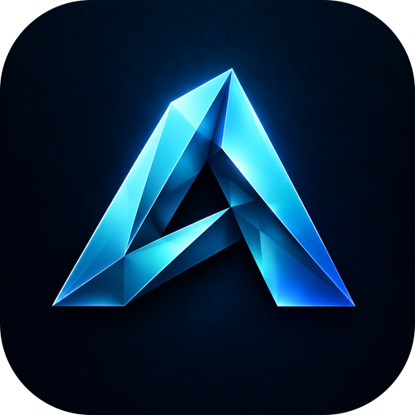
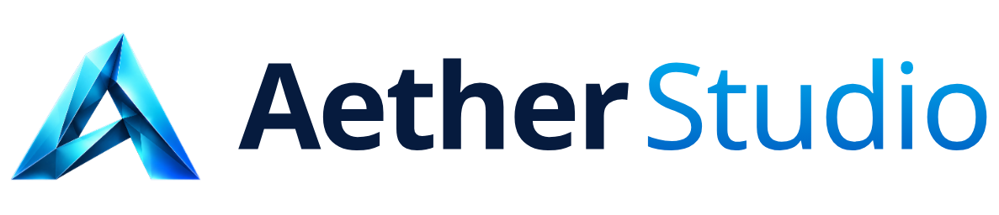
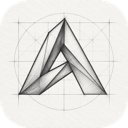

<!-- Product section generated by AetherStudio/dev/site/build_pages.py (apps.py). Edit there; developer notes below the line are kept. -->

> **Alpha 0.1:** [release setup, shared UI and current limitations](ALPHA_0_1.md). Fetch the checksum-locked vendor packages before installing dependencies.

<p align="center"></p>

<h1 align="center">
  <picture>
    <source media="(prefers-color-scheme: dark)" srcset="assets/branding/aether-studio-wordmark-dark.png">
    
  </picture>
</h1>

<p align="center">Your team's server: accounts, shared files, versions and live collaboration.</p>

<p align="center">
  
  
  <a href="https://jenkinsrobotics.github.io/AetherStudio/"></a>
</p>

Aether Studio runs on your own hardware — a Mac Studio in the office or a farm of servers — and gives every Aether app one place for accounts, files, versions, AI connections and live collaboration. Aether Drive ships inside it. Aether Drive, accounts and PDM — on your own hardware.

> **Alpha 0.1 — early access.** Aether Studio is alpha software: features are incomplete,
> file formats may change between alphas, and it is not yet qualified for production
> work. Every feature below is marked as working today, in progress or planned.

## Features

### Works today

- ✅ **Aether Drive** — My files, Shared, Recycle bin, workspaces and organisations; drag-and-drop upload, previews and an Admin Center.
- ✅ **Versions and branches** — Branch storage, a visual version graph, releases and obsolescence, restore and recovery for every document.
- ✅ **Accounts and sharing** — One sign-in across every app, account preferences, permissions and shared workspaces.
- ✅ **Comments and tasks** — Discuss a document and assign work beside it.
- ✅ **AI connections** — Connect ChatGPT, Claude or Gemini once under Plugins → My connections; every app's AI advisor uses it.
- ✅ **CLI and MCP** — A native agent bridge with scoped grants, explicit receipts and revision-guarded commands for every app.
- ✅ **Player deployment** — Pairs and deploys Aether Map shows to Raspberry Pi players.

### In progress

- 🔨 **Concurrent editing** — Real-time co-editing inside each app, with conflict handling on branches.
- 🔨 **Company network** — A trusted company-network address for every device on site.
- 🔨 **Scale** — Measured performance for hundreds of live connections.

### Planned

- 🗺️ **Desktop downloads** — Each app as a downloadable desktop app, standalone or connected.
- 🗺️ **Approvals** — Review and release approval workflows with audit history.
- 🗺️ **Fleet** — Set up, update and monitor players and controllers across sites.

## Built-in AI · Works today

Connect ChatGPT, Claude or Gemini once in Aether Studio (**Plugins → My connections**).
Agents use the app's own commands — validated, undoable and recorded. AI is optional:
nothing you save ever needs it.

- Studio owns the connection to your AI provider and grants each app's agent only the tools that app exposes.
- Every agent operation is scoped, revision-checked and recorded with a receipt, and the same tools are available from the command line and MCP.
- The same tools are available from the command line and as MCP tools, with scoped permissions and safe retries.

Example: aether-agent run map.scene.create --operation-id create-side-scene < scene.json

## What every Aether app brings

- **Runs on its own.** Open an app on one machine and work locally. Your files stay on your disk in open, documented formats. _(local install today · downloadable desktop app planned)_
- **Or on your own server.** Point the apps at an Aether Studio server — a Mac Studio in the office or a rack of machines — and the whole team works from one place.
- **Any device.** Every app is a web app first, so laptops, desktops and tablets connect through a browser — no install on the client. _(desktop downloads planned)_
- **Built-in AI.** Connect ChatGPT, Claude or Gemini once in Studio. Each app's AI advisor edits your open document with the app's own tools — and AI is never required to open or play your work.
- **PDM and version control.** Versions, branches, releases and obsolescence for every document, with a visual version graph and restore.
- **Multi-user.** One account across every app, shared workspaces, permissions, comments and tasks. _(real-time co-editing in progress)_
- **Command line and MCP.** Every agent tool is also a CLI command and an MCP tool, with scoped grants, revision guards and retry receipts.
- **Open source.** Apache-2.0. Own your tools, your files and your server.

## Roadmap

| Release | Focus | What it means |
|---|---|---|
| Alpha 0.1 | Server and Drive | Native server, Drive, accounts, versions, comments, AI connections and the agent bridge. |
| Alpha 0.2 | Live together | Concurrent editing and the company-network address. |
| Beta | Downloads and approvals | Desktop apps, approvals and fleet management. |

## Get started

```sh
git clone --branch v0.1.0-alpha.1 --single-branch https://github.com/JenkinsRobotics/AetherStudio.git
cd AetherStudio
python3 tools/fetch-vendor.py
```

See [Alpha 0.1 setup and current limits](ALPHA_0_1.md) for frontend build and
server requirements. The web download is a frontend bundle, not a desktop installer.

See the [website](https://jenkinsrobotics.github.io/AetherStudio/) for the full tour.

## The Aether apps

| | App | What it's for | Links |
|---|---|---|---|
|  | Aether CAD | 3D parametric parts, assemblies and production drawings. | [Site](https://jenkinsrobotics.github.io/Aether-CAD/) · [GitHub](https://github.com/JenkinsRobotics/Aether-CAD) |
|  | Aether Animation | Animate characters and animatronics, then play the motion on real servos. | [Site](https://jenkinsrobotics.github.io/Aether-Animation/) · [GitHub](https://github.com/JenkinsRobotics/Aether-Animation) |
|  | Aether Map | Projection mapping and unattended show playback on Raspberry Pi players. | [Site](https://jenkinsrobotics.github.io/Aether-Map/) · [GitHub](https://github.com/JenkinsRobotics/Aether-Map) |
|  | Aether Sketch | Drawing and sketching — clean vector paths today, expressive brushes next. | [Site](https://jenkinsrobotics.github.io/Aether-Sketch/) · [GitHub](https://github.com/JenkinsRobotics/Aether-Sketch) |
|  | Aether IO | Electronics and wiring for motion hardware. | [Site](https://jenkinsrobotics.github.io/Aether-IO/) · [GitHub](https://github.com/JenkinsRobotics/Aether-IO) |
|  | Aether Vector | Vector illustration and graphic design. | [Site](https://jenkinsrobotics.github.io/Aether-Vector/) · [GitHub](https://github.com/JenkinsRobotics/Aether-Vector) |
|  | **Aether Studio** | **Your team's server: accounts, shared files, versions and live collaboration.** · you are here | [Site](https://jenkinsrobotics.github.io/AetherStudio/) · [GitHub](https://github.com/JenkinsRobotics/AetherStudio) |

---

## Developer notes

## GitHub checkout handoff — 2026-10-10

Active development is now in `AetherStudio`. The existing app snapshot was
imported from `Temp Aether` into this GitHub-linked checkout. Source history and
original starter files are preserved there; this checkout keeps its GitHub
history and origin. No upload or running-installation cutover was performed.
Studio (server, Drive and shared packages) lives in `../AetherStudio`.
Earlier migration notes below describe historical folder names.

## Local repository handoff — 2026-10-09

This is the new local development home. The folder split, package boundaries,
setup/build integration and local Git history are complete. The original monorepo
remains the running deployment and historical backup. The GitHub origin is configured; see SOURCE_HISTORY.json.
See [development setup](../AetherStudio/LOCAL_DEVELOPMENT.md) and
[verification](../AetherStudio/migration/LOCAL_STRUCTURE_COMPLETE.md).
The earlier extraction notes below describe the initial snapshot.

# Aether Studio

Local migration candidate for Aether. Extracted from the current working source,
including uncommitted changes. **Production still uses the original Aether Studio
checkout.** Read `MIGRATION.md` before switching development to this folder.

## Build

Use Node 22.12+ and npm. From `studio`:

```sh
npm ci
npm run build
```

Shared Aether packages are versioned archives under `vendor/`, with lockfile
integrity checks. No frontend imports source from the original checkout. Archives
are temporary local distribution until the package registry is configured.
The platform serves these builds using `projects.json`.

The existing product README is retained as `README.pre-split.md` where present.
Some older paths in historical documentation refer to the former monorepo.

## Local installation

Keep the sibling app folders alongside this folder, or edit `projects.json`.
Run `python3.11 bootstrap.py` to install Python and web dependencies and build the
suite. This uses only the new projects. The bootstrap does not start a server or
change login items, launch agents, or existing installation data.

The installed local server is now Rust/PostgreSQL at `http://localhost:8780`.
Run `.venv/bin/python dev_server.py` to inspect it. The original Python hosts are
retired; do not reactivate their databases as writers. For an isolated native
development installation, follow [native setup](dev/rebuild/NATIVE_INSTALLATION.md).
See [the current cutover status](dev/rebuild/CUTOVER_STATUS.md) for data preservation,
verification and the remaining release gates.

Remaining architecture work is recorded in `migration/IMPLEMENTATION.md`.
